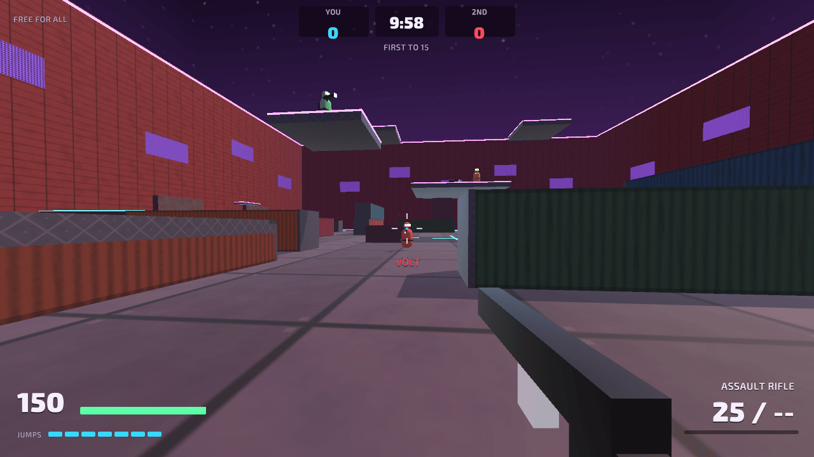
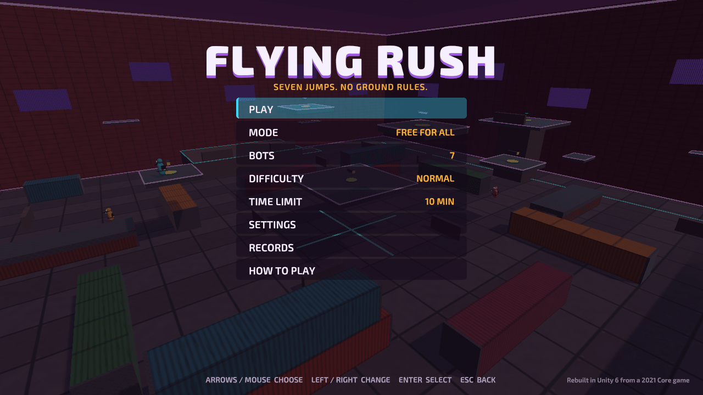
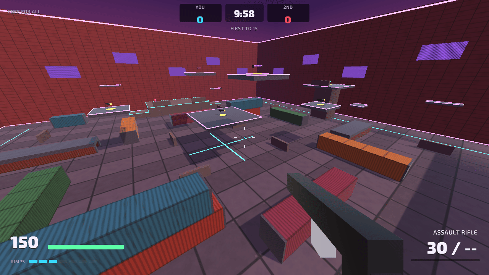
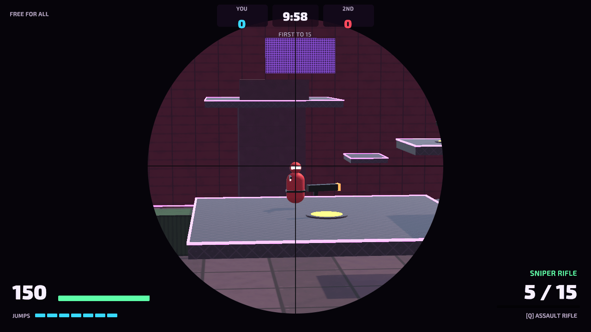
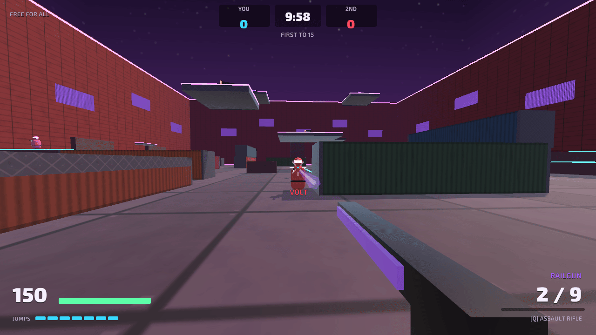
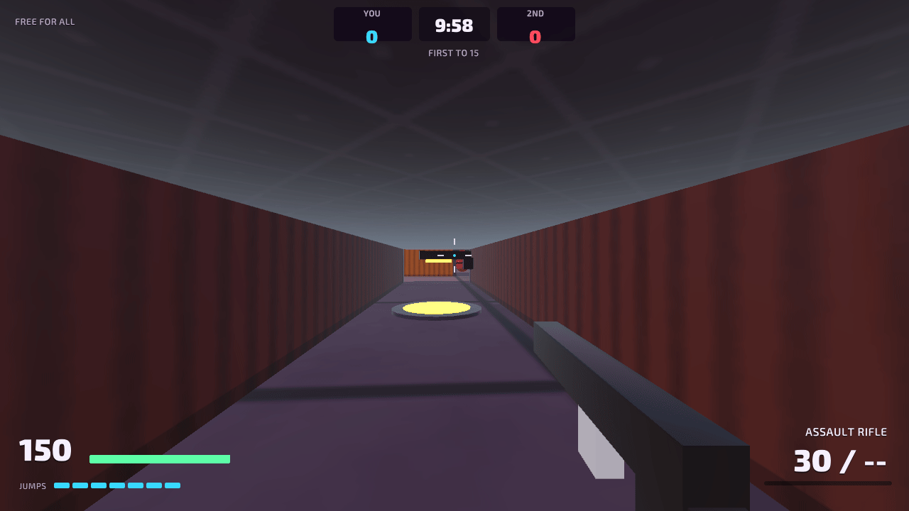
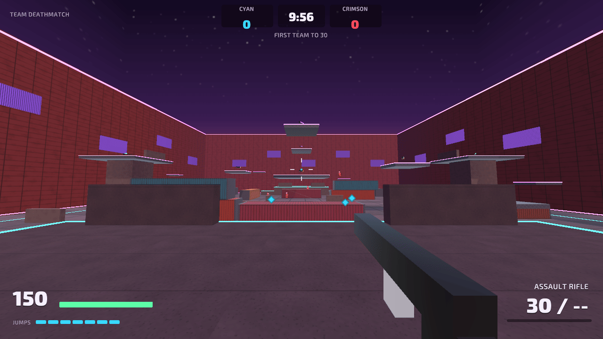
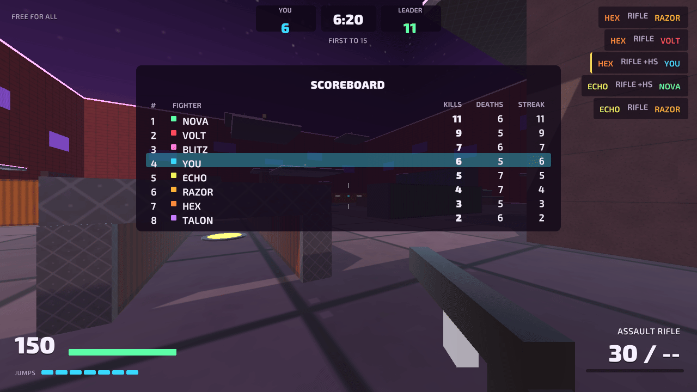
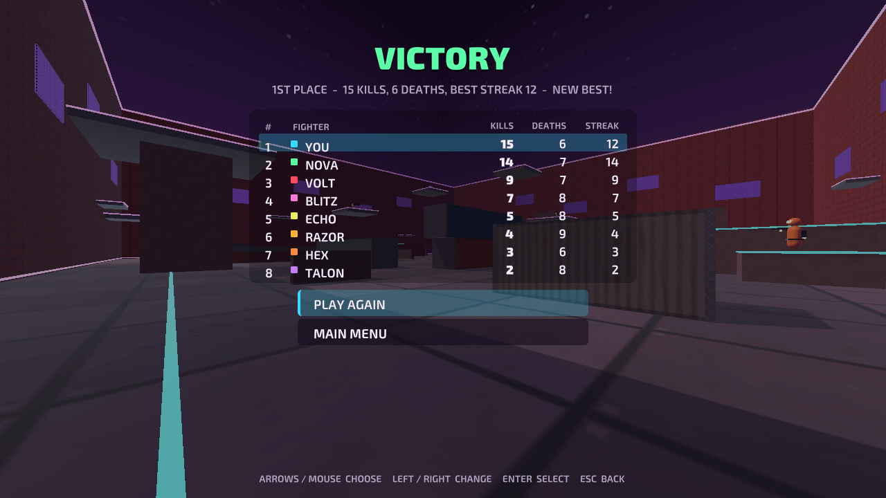
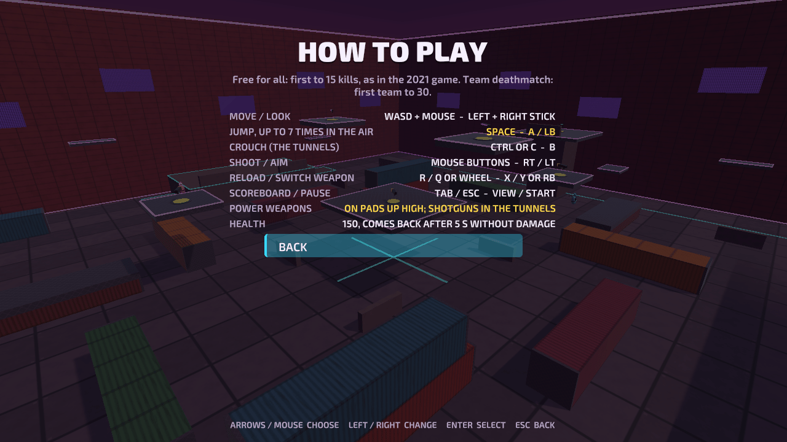

# Flying Rush

A first-person arena shooter against bots, built with Unity: a closed cage of shipping
containers, sniper towers and floating platforms where everyone can jump seven times before
touching the ground again, so fights happen in the air as much as on the floor. Free for all to
15 kills or team deathmatch to 30, five weapons, three bot difficulty levels, and it plays with
a keyboard and mouse or a gamepad.

It is a rebuild of a game I made in 2021 in Core, Manticore Games' platform, which can no
longer run it (see [Where it came from](#where-it-came-from)).



| | |
|---|---|
|  |  |
|  |  |
|  |  |
|  |  |
|  | |

## Play it

- **In your browser:** [trysac.github.io/Flying-Rush](https://trysac.github.io/Flying-Rush/)
- **On itch.io:** [trysac.itch.io/flying-rush](https://trysac.itch.io/flying-rush)
- **Get the code:** fork this repository, or clone it:

  ```bash
  git clone https://github.com/Trysac/Flying-Rush.git
  ```

## Run it

1. Install **Unity 6000.3.27f1 (Unity 6 LTS)** with Unity Hub (add the Windows or Web build
   support module if you want to build players).
2. In Unity Hub choose **Add → Add project from disk** and select the repository folder.
3. Open `Assets/Scenes/Main.unity` and press **Play**. Click the game view to capture the mouse.

To build a player use **File → Build Profiles** (Windows or Web), or build from a terminal into
a folder outside the repository:

```bash
Unity -batchmode -quit -projectPath . -executeMethod FlyingRush.EditorTools.ProjectBuilder.BuildWebGL -buildOutput ../build/web
```

(`BuildWindows` works the same way.) The WebGL build is uncompressed, so it runs from any
static host such as GitHub Pages.

The tests run from **Window → General → Test Runner** (EditMode and PlayMode), or from a terminal:

```bash
Unity -batchmode -projectPath . -runTests -testPlatform EditMode -testResults results.xml
Unity -batchmode -projectPath . -runTests -testPlatform PlayMode -testResults playmode.xml
```

The scene, materials, textures, sky, font atlases, icon, physics layer names and player
settings are generated by **Flying Rush → Regenerate Art, Scene and Player Settings**
(`ProjectBuilder.SetUpProject`), and the sounds by `python tools/audio/build.py` (needs
ffmpeg). The README screenshots come from an opt-in hook: run a built player with
`-screenshot <folder>` (optionally `-scenario title,fight,flying,...`), or, without a player,
`Unity -batchmode -projectPath . -executeMethod FlyingRush.EditorTools.ProjectBuilder.CaptureScreenshots -screenshot <folder>`.

## Controls

| Action | Keyboard and mouse | Gamepad |
|---|---|---|
| Move / look | WASD / mouse | Left stick / right stick |
| Jump: one from the ground and up to six more in the air | Space | A or LB |
| Crouch (the tunnels need it) | Left Ctrl or C | B or right stick click |
| Shoot / aim down the sights | Left / right mouse button | RT / LT |
| Reload | R | X |
| Switch weapon | Q, 1, 2 or the wheel (each press swaps between the rifle and the power weapon) | Y or RB |
| Scoreboard | Tab (held) | View (held) |
| Pause | Esc or P | Start |
| Menus | ↑ / ↓ or the mouse to choose, ← / → to change a value, Enter to select, Esc to go back | D-pad or stick, A to select, B to go back |

## How it plays

- **Rules from 2021.** Free for all against up to seven bots, first to 15 kills, 150 hit
  points, seven jumps, an assault rifle to start with and the power weapons up high: the values
  of the original game's settings. A match starts with a three-second countdown, fighters come
  back three seconds after dying at the spawn farthest from their enemies, and the round ends
  five seconds after the last kill. Added: team deathmatch (the player and the bots split into two teams from the two
  bases, first team to 30, no friendly fire), a 5 or 10 minute time limit (10 by default, or off as in 2021), spawn
  protection and health that regenerates 20 a second after 5 seconds without damage.
- **Flying.** A ground jump and six air jumps, each one refilled when you land, take you up
  about 11 metres: onto the containers, the sniper towers, the ledges on the cage walls and the
  floating platforms. The HUD shows the jumps you have left.
- **Weapons.** The assault rifle (endless spare ammunition) and four power weapons on pads that
  come back 20 seconds after someone takes them: shotguns inside the two crouching tunnels, a
  sniper rifle on each tower (one shot to the head kills), rocket launchers on the platforms
  (splash damage, knockback and rocket jumps, your own rockets hurt you a third as much) and a
  railgun on each of the two highest platforms (it goes through every fighter on its line).
  Headshots, damage falloff and spread, wider in the air and tighter down the sights.
- **Bots.** They follow a waypoint graph that links the floor and every top they can reach by
  walking, dropping or multi-jumping; they look for enemies with line-of-sight checks, close in
  to their weapon's range, strafe, jump, back off to cover when hurt, collect weapons and pick
  the right one for the distance. They react late and miss on purpose: easy, normal and hard
  change the reaction time, the aim error, how fast they turn and how hard they hit.
- **Feedback.** Muzzle flashes, tracers, impact sparks, the railgun beam, explosions, hit
  markers (gold for headshots, red for kills), damage direction arrows, a low-health vignette,
  screen shake, kill streak banners, a kill feed and a moment of slow motion at the end.
- **Records** on the device (PlayerPrefs) for each mode: matches and wins, the most kills in a
  match, the longest streak and kills per death. The settings (look sensitivity, inverted look,
  field of view, volume, music, screen shake and the last match setup) are saved too.

## What I learned / technically interesting

- **Rules without the engine.** Weapons, health, the seven jumps, the match rules, team
  balance, spawns, records and settings, the map layout, the bots' waypoint graph with A* and
  the bots' decisions live in `Assets/Scripts/Core`, a plain C# assembly with no Unity
  references, covered by 94 deterministic EditMode tests: seeded generators make spread and
  aim errors repeatable, and the tests check things like "every waypoint can be reached from
  every spawn", "every block has a half-turn twin so neither team has the better side" and
  "no link climbs higher than the jumps allow". 15 PlayMode tests drive the real scene: title,
  countdown, shooting a bot dead, respawning, weapon pads, the kill limit and the results,
  pause, restart, team deathmatch, settings, falling out and bots finding their way round.
- **The map as data.** The cage is a list of boxes in the core. The game turns it into meshes
  and colliders; the core turns it into the bots' waypoints, checking every climb as "straight
  up over the lower point, then across", the same path the bot controller then flies.
- **Bots that miss well.** A soak run showed bots plinking at each other from across the cage
  and landing one hit in ten. The fixes were tested in the core: an engage range per weapon, a
  short memory for an enemy that ducks out of sight, a trigger cone measured from where the bot
  means to aim (so the designed error is the real error) and jump rates per second instead of
  per frame.
- **Everything is generated.** Meshes, textures (corrugated containers, floor plates, wall
  panels, neon grids, the sky), materials, the scene, the font atlases, the icon and the player
  settings come from an editor script (`ProjectBuilder.cs`); the sounds and both music tracks
  come from a small Python synthesizer (`tools/audio`). The HUD and menus are UI Toolkit,
  built in code (`Hud.cs`) and styled with USS.

## Where it came from

Flying Rush started in March 2021 as a game made in **Core** by Manticore Games, on its
"Deathmatch" framework, published there as "Death Cage". Core can no longer build or run it,
so in 2026 the game was rebuilt from scratch in Unity 6 on the same idea, map and rules; the
original settings it keeps are listed in [docs/original](docs/original/README.md). None of the
Core project's assets or community content is used: the Core files stay in the git history
only.

## Credits

- **Original game and platform:** the 2021 version was made with Core by Manticore Games.
- **Fonts:** Exo 2 Black and Exo 2 SemiBold by Natanael Gama, licensed under the
  [SIL Open Font License 1.1](Assets/Fonts/OFL.txt); they ship unmodified in `Assets/Fonts`.
- Everything else (code, meshes, textures, sounds, music, icon) was made for this project. See
  [CREDITS.md](CREDITS.md).

## License

The code and the generated assets are under the [MIT License](LICENSE). The Exo 2 fonts keep
their own SIL Open Font License (`Assets/Fonts/OFL.txt`).
